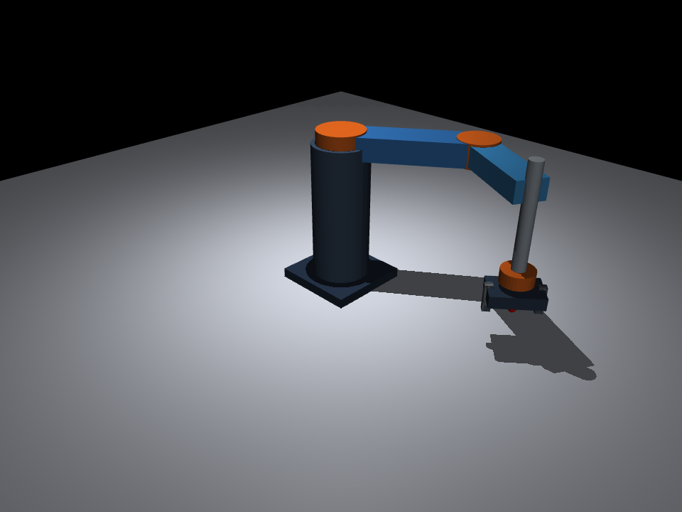

# SCARA Robot Manipulator

This is a computer-only SCARA robot project built for MuJoCo. The robot has two rotary arm joints, a vertical sliding joint, a rotary wrist, and a moving two-finger gripper.

Double-click [kinematics.cmd](kinematics.cmd). In Joints, click **Go to object**, then **Close / pick up** and move the sliders. **Open / release** leaves the connector at its current pose. F1/F2/F3 switch modes; the object stays visible. Pickup uses kinematic attachment without contact-force simulation.

## SCARA Robot

## Project checklist

- [x] 1. Define the robot geometry, joint limits, masses, frames, and sign conventions.
- [x] 2. Build the model and assign frames/DH parameters.
- [x] 3. Derive forward and inverse kinematics, including unreachable targets.
- [x] 4. Derive velocity kinematics (the Jacobian), and identify singularities.
- [x] 5. Derive forward and inverse dynamics from the robot’s energies.
- [x] 6. Plan a timed path, then control the actuators to track it (unloaded MuJoCo model).
- [x] 7. Add a simulated task with objects, grasp/release, and collision constraints. [Pick-and-place demo](docs/task/README.md)
- [ ] 8. Validate the equations and measure task results: tracking error, placement accuracy, effort, failures, and cycle time.
