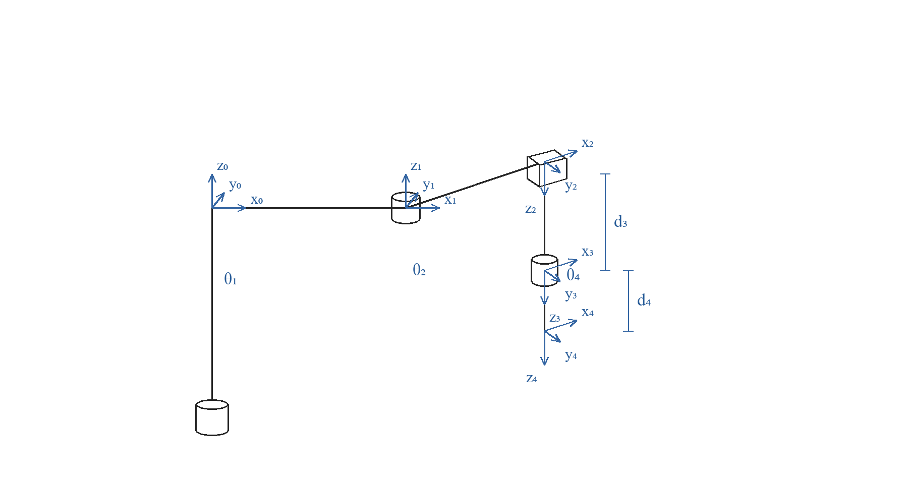
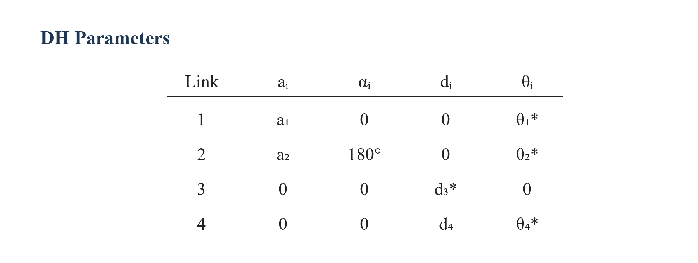

# Frame assignment and DH table

The class slide shows an R–R–P arm followed by a vertical-axis rotary wrist. We use the **standard** DH transform

$$
A_i=R_z(\theta_i)T_z(d_i)T_x(a_i)R_x(\alpha_i),
\qquad {}^0T_4=A_1A_2A_3A_4.
$$

World +Z is upward. The shoulder origin $O_0$ is at world (0, 0, 0.280 m). Frames 0 and 1 have upward +Z. The 180-degree twist after link 2 makes frames 2, 3, and 4 point **downward** along +Z. The slides supplied by the user are preserved as `lecture_scara_frames.png` and `lecture_scara_dh.png`.

The diagram is a line sketch generated with Python from MuJoCo's posed joint centers and orientations. It is a direct structural pose, not simulated tracking.

| i | $a_i$ (m) | $\alpha_i$ | $d_i$ (m) | $\theta_i$ |
| --- | ---: | ---: | ---: | --- |
| 1 | 0.240 | 0 | 0 | $q_1$ |
| 2 | 0.180 | $\pi$ | 0 | $q_2$ |
| 3 | 0 | 0 | $0.080+q_3$ | 0 |
| 4 | 0 | 0 | 0.075 | $q_4$ |

The class table has $d_1=d_2=0$, so the world-to-shoulder height is a separate transform ${}^WT_0=T_z(0.280)$. The lecture labels the prismatic variable $d_3^*$. In our model, MuJoCo's slider coordinate $q_3$ starts at zero and $d_3^*=0.080+q_3$; its permitted range is 0.080 to 0.190 m. This offset keeps the simulator's neutral configuration inside its slide limit. It does not change the DH topology.

At zero angles, the world-space tool position is (0.420, 0, 0.125) m. Composing the DH transforms gives the position check used in `scripts/model/check_model.py`:

$$
p_x=a_1\cos q_1+a_2\cos(q_1+q_2),\quad
p_y=a_1\sin q_1+a_2\sin(q_1+q_2),\quad
p_z=h-d_3-d_4.
$$

This position equation is only a structural cross-check for our frame assignment. The teammates' forward-kinematics work should derive and present the full homogeneous transform, including orientation and all intermediate matrices, from the same convention.

## Map to simulator frames

The simulator bodies are construction frames, so the DH frame 2 twist is **not** an extra physical joint. MJCF's shoulder and elbow hinge axes are local +Z; the vertical slide and wrist hinge axes are local −Z. Thus positive $q_3$ moves the carriage down and positive $q_4$ rotates about the downward wrist axis. The `tool` site in MJCF and the fixed `tool` link in URDF are 0.075 m below the wrist center. The left/right finger slide axes are local +Y/−Y and are outside the four-row arm DH table.

MuJoCo's four arm coordinates are ordered shoulder, elbow, vertical, wrist. The two gripper coordinates follow. Right-handed rotations and SI units are used throughout. Numerical sample checks confirm that the tool site agrees with the DH position formula to below 0.2 micrometres for the tested poses. They do not prove tracking or grasp performance.

