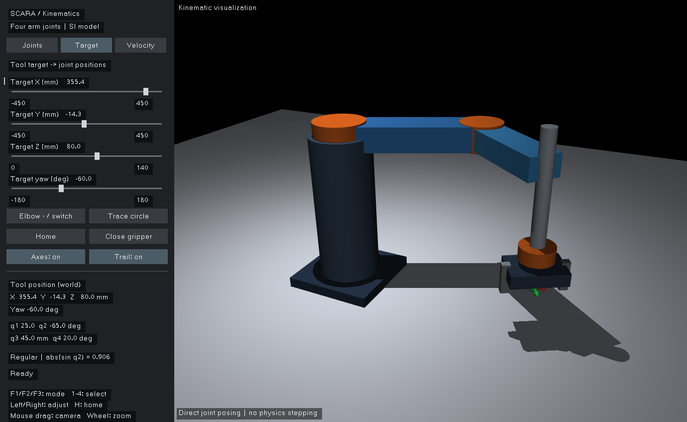

# Interactive kinematics viewer

Double-click `kinematics.cmd` in the project folder, or run this from the project root:

```powershell
.\.venv\Scripts\python.exe scripts\interactive\kinematics_viewer.py
```

It opens one native MuJoCo window with three tabs. Drag a slider to change its value, or select a slider with keys 1–4 and adjust it with Left/Right. F1, F2, and F3 switch between tabs.

| Tab | Controls and result |
| --- | --- |
| Joints | Set shoulder, elbow, slide, and wrist positions. The tool position and yaw update using FK. Straight arm shows the extended singular configuration. |
| Target | Set tool X, Y, Z, and yaw. IK positions the robot; the elbow button switches branches. A valid target is green. An unreachable target is red and the robot holds its last valid pose. Trace circle moves through successive IK position targets and leaves a trail. |
| Velocity | Set the four joint speeds, then press Run velocities. The Jacobian calculates tool velocity from the actual clipped joint rates. A yellow arrow shows linear velocity, scaled by 0.7 seconds; yaw speed is shown numerically. Pause stops motion; Zero velocities clears the inputs. |

The common buttons return Home, pose the gripper open/closed, show world-axis arrows at the tool, and toggle the trail. Home stops running motion and restores the initial pose. Mode switching zeros velocity inputs. Motion pauses when the window loses focus.

Drag in the 3D view to rotate the camera. Shift-drag moves the view; the mouse wheel zooms. H returns the joints Home, B switches IK branches in Target mode, and Space starts/stops the circle in Target mode or velocities in Velocity mode. Escape closes the window.

Positions use mm and angles use degrees in the panel. The equations and model use SI internally. The red/green/blue tool arrows show world X/Y/Z. The target arrow shows requested yaw. The singularity readout is the dimensionless quantity $|\sin q_2|$; it is zero at singular configurations. The on-screen Near singular label uses a display threshold of 0.12.

The velocity tab demonstrates forward velocity kinematics:

$$
\dot{x}=J(q)\dot{q},\qquad x=[x,y,z,\phi]^T.
$$

Teaching speed sliders are capped at 60 deg/s for the first two joints, 60 mm/s for the slide, and 90 deg/s for the wrist, or the configured limit if smaller. Integration clips positions to the configured joint limits and uses the resulting joint rates for the tool-velocity readout. The trail holds the most recent 240 samples.

This is a kinematic visualization. It directly sets joint positions and calls MuJoCo forward calculations; it does not step dynamics. The circle is a sequence of exact position-IK poses. Switching IK branches changes pose immediately and does not plan the intervening motion. Collision-free paths, grasping, actuator tracking, and inverse velocity are outside this viewer's scope.

The code uses the existing FK, IK, and Jacobian functions in `scripts/kinematics/scara_kinematics.py`. The scene and collision geometry come from `models/scara.xml`; the viewer does not regenerate or modify the CAD/model files.

## Verification

```powershell
.\.venv\Scripts\python.exe scripts\interactive\kinematics_viewer.py --check
.\.venv\Scripts\python.exe scripts\kinematics\check_kinematics.py
.\.venv\Scripts\python.exe scripts\model\check_model.py
```

The viewer's check covers FK edits, IK branch switching, invalid-target hold, velocity agreement with position finite differences, joint-limit clipping, stopped rates after a mode change, and a complete sampled circle. Native mouse/keyboard interactions were also exercised in the viewer.


